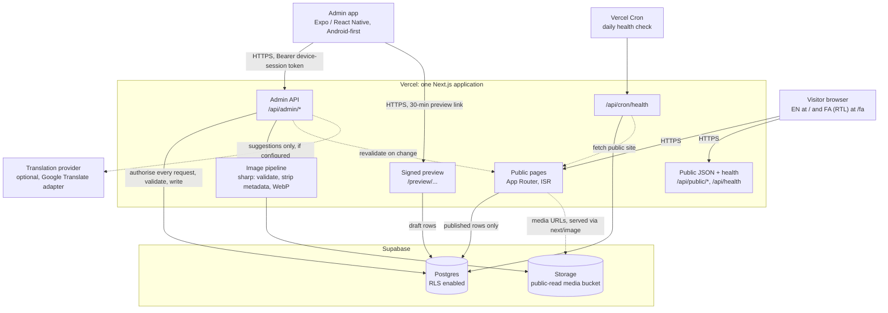

# Architecture

Describes the reviewed implementation. Diagram source: [`diagrams/system-architecture.mmd`](diagrams/system-architecture.mmd).

## Website frontend and routing
Next.js App Router. English is the default locale at the root; Persian lives under `/fa` as real routes (no client-side language switching). Pages: Home, About, Experience, Performances, Gallery, Tickets (+ detail), Shop (+ detail), Contact. A shared helper maps any path to its counterpart in the other language, which drives the language switcher and hreflang. The `<html>` `lang` and `dir` attributes are set per locale. Fonts include Vazirmatn and Estedad for Persian.

Rendering: static with revalidation. Content pages revalidate daily; Tickets and Shop every 60 seconds. Admin writes additionally call `revalidatePath`, so edits appear without a redeploy.

## Content model
Built-in TypeScript content files are the defaults. Database rows are layered on top:
- `site_pages`: page text per page and language (published `fields`, pending `draft`). A field never saved falls back to the default; a field saved empty is omitted from the page.
- `site_collections` / `site_items` / `site_item_translations`: ordered lists with stable ids, explicit position, visibility and **one row per language** so each language publishes independently.
- `site_image_slots`: the About photograph.
- Numbers shown on the site (areas, performances) are derived from order and never stored.
- On first use of a list, current website content is copied in (seeded) so nothing is lost.

Tickets and Shop have their own tables: `events` (+ translations, custom information blocks), `products` (+ translations, images, variants, inventory ledger), `shop_settings`. Money is stored as integer minor units with an ISO currency.

## Admin API
A single catch-all route handler (`/api/admin/[[...path]]`) dispatches to a small regex router. Every route except activation requires a valid session. Groups: session/activation, dashboard and activity, events, products and inventory, shop settings, content pages and collections (including publish/unpublish/discard/image), translate, health. Responses are `no-store` and `noindex`. Validation uses Zod; errors use a typed `ApiError` with stable codes.

## Authentication
See [docs/api-and-data-flow.md](docs/api-and-data-flow.md). Summary: single-use activation codes create per-device session tokens; only SHA-256 hashes are stored; the server re-verifies the token on every request; sessions can be revoked.

## Database and media storage
Postgres with row-level security enabled on all application tables. Public roles can read only published, visible rows; the server connects with a privileged role and enforces authorisation in code. Media: one public-read Storage bucket restricted (by bucket configuration) to WebP and 4 MB; writes happen only server-side. Uploads are decoded with `sharp`, orientation applied, metadata stripped, resized to at most 2000 px and re-encoded as WebP.

## Error handling and publishing workflow
- Saving in the app writes drafts; only **Publish** changes the public site (per language). Reordering and deleting apply immediately.
- The public reader never selects draft columns; public database roles have no `SELECT` privilege on them.
- Database unavailable: a production **build** fails rather than shipping built-in/empty content (override: `ALLOW_BUILD_WITHOUT_DATABASE=1`); at **runtime** the last good cached page is kept.
- Client errors in the app are classified (network, unauthorized, http, config); a 401 clears the session and returns to activation.

## Deployment
Vercel (Next.js) + Supabase. A cron entry in `vercel.json` calls the health route daily. The Android app is built separately with EAS profiles (`preview` APK, `production` AAB). See [docs/deployment-overview.md](docs/deployment-overview.md).

## Implementation vs. proposal

| Item | Status |
| --- | --- |
| Bilingual website, SEO, structured data | Implemented |
| Device-session admin authentication | Implemented |
| Content CMS with draft/publish and preview | Implemented |
| Tickets (external links) and Shop (no checkout) | Implemented |
| Health checks | Implemented |
| Payments, carts, orders | Not implemented (schema notes only) |
| Product variants admin/public UI | Not implemented (tables exist) |
| Audio/video file upload | Not implemented (links only) |
| Admin app in Persian | Not implemented (content fields are bilingual, UI is English) |
