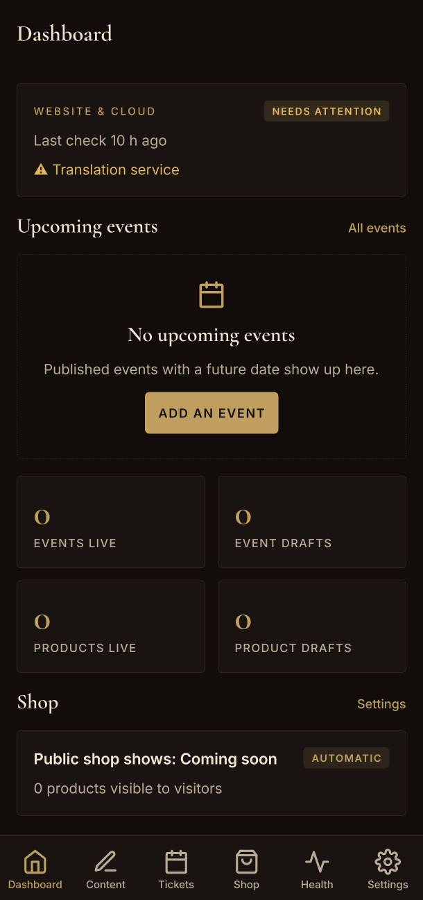
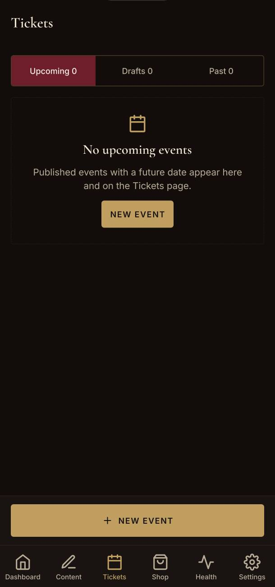
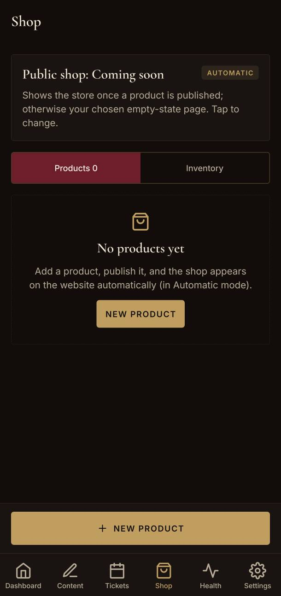
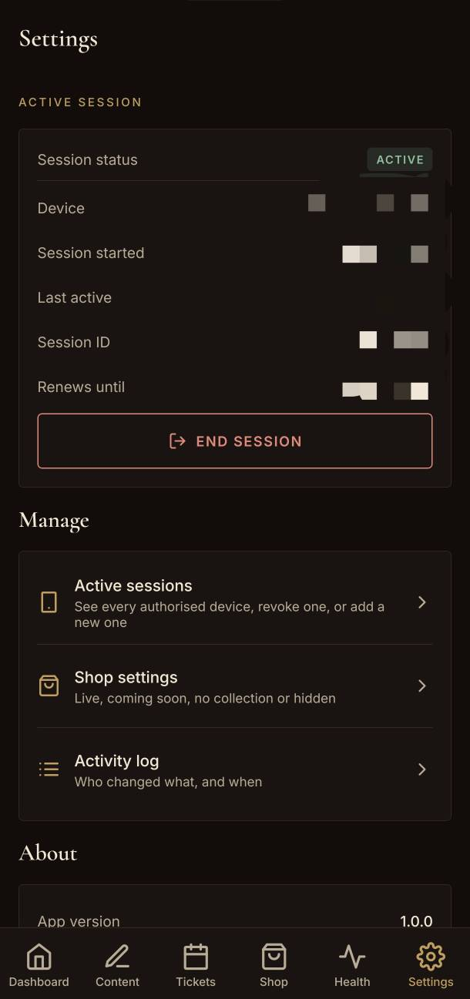
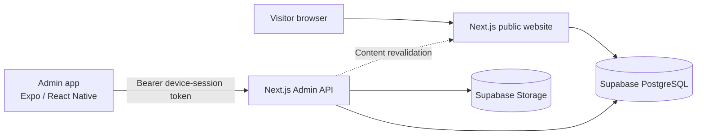

# Sina Eftekharinia Platform — Engineering Case Study

**A bilingual artist platform, a custom content management system, and an Android-first administration app.**

A software engineering case study covering architecture, content modelling, publishing workflows, API security, testing, and deployment design for a professional violinist's digital platform.

  <a href="https://sinaeftekharinia.vercel.app/">
    <strong>Live Website</strong>
  </a>
  &nbsp; · &nbsp;
  <a href="docs/website-showcase.md">Website Showcase</a>
  &nbsp; · &nbsp;
  <a href="docs/admin-app-showcase.md">Admin App</a>
  &nbsp; · &nbsp;
  <a href="ARCHITECTURE.md">Architecture</a>

---

## At a Glance

| Area | Details |
|---|---|
| Project type | Full-stack web platform and mobile administration system |
| Public experience | English and Persian, including RTL support |
| Web framework | Next.js App Router, React, TypeScript |
| Backend | Next.js Admin API |
| Data and media | Supabase, PostgreSQL, Supabase Storage |
| Administration | Expo, React Native, Expo Router |
| Deployment target | Vercel and Supabase |
| Repository scope | Documentation and engineering case study; application source is excluded |

## 01. The Product

The goal was to create a digital platform for a professional violinist that could serve two audiences: visitors discovering the artist and an administrator maintaining the website.

The solution brings three connected components together:

- **Public website:** a bilingual, search-engine-oriented experience for the artist's biography, experience, performances, gallery, tickets, shop, and contact information.
- **Admin API:** a server-side boundary for authenticated content operations, validation, publishing, media processing, and operational checks.
- **Android-first admin app:** a mobile interface for managing website content without editing source code or deploying a new website version for every content change.

The central engineering challenge is maintaining a clear separation between public content and administrative operations while supporting two languages and a controlled publishing workflow.

## 02. Website Preview

The website supports English and Persian experiences, with localized routes and right-to-left presentation for Persian.

### English Homepage

  

### Persian Homepage

  

**Key considerations**

- Localized, crawlable page routes.
- Language-aware document direction and metadata.
- Search engine metadata, canonical URLs, alternate-language links, sitemap, and structured data.
- Public performance and product listings driven by published content.
- Reduced-motion support and a skip link.

See the [Website Showcase](docs/website-showcase.md) for additional implementation details.

## 03. Content Management System

The administration system is designed to make routine content changes possible without a developer manually editing the website.

### Dashboard

  

### Content Editing

  

### Events and Performances

  
  &nbsp;
  

### Shop and Products

  
  &nbsp;
  

### Settings and Site Health

  
  &nbsp;
  

### Content workflow

The reviewed implementation supports:

- Independent English and Persian content entries.
- Editing page text, biographies, ordered sections, performances, education, orchestras, galleries, social links, and media archives.
- Drafting, publishing, unpublishing, discarding, and restoring content.
- Preview links with expiration, signatures, and `noindex` handling.
- Event and product management.
- Image selection, processing, and upload from the administration app.
- Operational checks for website, SEO, database, and storage configuration.

Content order is used to derive numbering where applicable, and optional empty fields can be omitted from the public presentation.

## 04. System Architecture

The platform separates the public visitor experience from authenticated administrative operations while keeping the website and Admin API in one deployable Next.js application.

**Request flow**

1. Visitors access the public website and its localized routes.
2. The administration app communicates with the Admin API using a device-session token.
3. The API validates administrative requests and performs permitted content or media operations.
4. Database-backed content is stored in Supabase; media is stored in Supabase Storage.
5. Publishing can trigger website revalidation so updated content becomes visible without a full deployment.

Further reading: [System Architecture](ARCHITECTURE.md) · [API and Data Flow](docs/api-and-data-flow.md) · [CMS Workflow](docs/cms-workflow.md)

## 05. Engineering Decisions

The project is more than a collection of pages. Its engineering decisions address the boundary between content creation, publication, and public delivery.

| Challenge | Engineering approach |
|---|---|
| Bilingual content | Independent English and Persian entries with localized presentation |
| Draft privacy | Administrative access controls and a separate preview workflow |
| Authentication | Device activation and expiring device-session credentials |
| Input validation | Server-side validation using Zod |
| Media handling | Server-side image processing and sanitization |
| Database resilience | Defined fallback behavior and default content |
| Publishing | Draft and published states, with revalidation |
| Maintainability | Dedicated architecture, workflow, security, and validation documentation |

These are descriptions of the reviewed implementation, not a claim that the platform has undergone an independent security audit.

See [Engineering Decisions](ENGINEERING-DECISIONS.md) for the reasoning behind these choices.

## 06. Technology Stack

| Layer | Technologies |
|---|---|
| Web | Next.js 16, React 19, TypeScript |
| Validation | Zod |
| Database | PostgreSQL, Supabase, PGlite for tests |
| Media | Supabase Storage, Sharp |
| Mobile | Expo 57, React Native 0.86, Expo Router |
| Mobile security | Expo SecureStore |
| Testing | Vitest, web and mobile test suites |
| Deployment | Vercel and Supabase |

Versions reflect the project manifests reviewed for this case study.

## 07. Testing and Validation

The recorded review snapshot reported the following results:

| Check | Recorded result |
|---|---|
| Web type-check | Passed |
| Web tests | 144 / 144 passed |
| Mobile type-check | Passed |
| Mobile tests | 32 passed; 1 live-server contract test skipped by design |
| Production web build | Completed |
| Production Android JavaScript bundle | Completed |

These results describe the reviewed development snapshot. They do not establish that every live integration, production deployment, or installed Android build has been independently verified.

The exact commands, scope, and limitations are documented in [Testing and Validation](docs/testing-and-validation.md).

## 08. Security and Privacy

Security is addressed at the administrative API boundary rather than relying on the mobile interface alone.

The documented design includes:

- Device activation through a single-use code.
- Device-session authentication without embedding a server secret in the app.
- Server-side validation of administrative inputs.
- Controlled content publishing and preview access.
- Media processing and validation.
- Operational checks for database and storage configuration.

No independent penetration test or formal security certification is claimed.

Read [Security and Privacy](SECURITY-AND-PRIVACY.md) for the security model, scope, and known limitations.

## 09. Documentation

This repository is organized to make the implementation understandable without including the application source code.

| Document | Purpose |
|---|---|
| [Project Proposal](PROPOSAL.md) | Problem statement, objectives, and scope |
| [Architecture](ARCHITECTURE.md) | System components and their relationships |
| [Engineering Decisions](ENGINEERING-DECISIONS.md) | Key technical decisions and trade-offs |
| [Website Showcase](docs/website-showcase.md) | Public website features and presentation |
| [Admin App Showcase](docs/admin-app-showcase.md) | Mobile administration experience |
| [API and Data Flow](docs/api-and-data-flow.md) | API responsibilities and request flow |
| [CMS Workflow](docs/cms-workflow.md) | Content editing and publishing lifecycle |
| [Deployment Overview](docs/deployment-overview.md) | Deployment architecture and operational considerations |
| [Testing and Validation](docs/testing-and-validation.md) | Recorded checks, results, and limitations |
| [Security and Privacy](SECURITY-AND-PRIVACY.md) | Security controls and known limitations |
| [License and Rights](LICENSE-AND-RIGHTS.md) | Ownership, permissions, and repository scope |
| [Contributing](CONTRIBUTING.md) | Documentation contribution guidance |

## 10. Scope and Limitations

This repository documents the reviewed implementation; it is not a runnable distribution of the website or mobile app.

The following were not verified as part of the recorded review:

- The live production deployment and all production integrations.
- A fully installed and validated Android build on a physical device.
- Live Supabase and machine-translation calls.
- Formal accessibility conformance and performance benchmarks.

Payments, ticket sales, product-variant management UI, and audio/video file uploads are outside the implemented scope described in this review.

## License and Ownership

The application source code is intentionally excluded from this repository and is not licensed through it. The rights and permissions applicable to the documentation and project materials are described in [LICENSE-AND-RIGHTS.md](LICENSE-AND-RIGHTS.md).

---

  <strong>Sina Eftekharinia Platform</strong> 
  Engineering case study · Bilingual web · Content management · Mobile administration

  